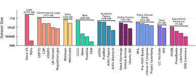
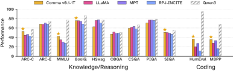

<header>
<h1>Can we fix AI?</h1>
<div class="subh1">part 1: data</div>
</header>

<ul class="links">
	<li>16 November 2026</li>
    <li><span class="todo">2: environment</span></li>
    <li><span class="todo">3: social impact</span></li>
    <li><span class="todo">4: misc</span></li>
</ul>

<figure class="narrow centering">

</figure>

AI has a problem. Specifically, modern generative-AI-based chatbots like ChatGPT and Claude have a problem. Not a technical problem. In fact, they work much better than most of their critics realize, and they're improving at an alarming rate.

The problem is that people don't _like_ them. Some people do. Others use them despite misgivings. A lot of people _really_ hate them. For a while, this was simply the way that it was: another topic for us all to get polarized over, but we could mostly live and let live. 

That's now starting to change. 

In a [recent essay](craft-coding), I made the claim that if you write safety-critical code, it is no longer responsible to do so without AI assistance. That is because AI can spot bugs---possibly exploitable bugs---that people can't. Writing code with some security aspect, say user management, without any AI review as part of your process, more or less guarantees that your users will be increasingly vulnerable to attack.

If you dislike modern AI---and I dislike many aspects of it myself---but you concede the above point, then this puts us in a very unpleasant position. We now have a tool that is absolutely crucial and at the same time morally objectionable to many people.

<aside>You may also think that AI criticism is overblown, or something in between. Hold your horses, we'll get into the weeds soon enough.
</aside>

This raises a natural question. **Can AI be fixed?** Can we build the same thing that we have now, with the power to do some of the things we now need it to do---like code review---but without the objectionable parts. And, while we're at it, what exactly are all the objectionable parts?

* toc
{:toc}

## Can we do without the bad parts?

This is really a two-part question. Take, for example, the [destruction of rare books](https://arstechnica.com/tech-policy/2026/08/hidden-airtag-reveals-amazon-is-trashing-rare-books-to-train-ai/) that some AI companies are now engaged in. They are doing this simply to create a private repository of data that many others have already created for themselves. This is something that is _technically_ utterly unnecessary. For one thing, the data already exists several times over, and for another, Google (the first to do it) have shown that the scanning can be done non-destructively. So technically, yes, we can absolutely build AI without destroying books.

That's an interesting conclusion, but not a very practical one, since the current system is still set up so that destructive book scanning is the move these companies feel forced to make. We can do it without, but we aren't doing it without. So we must also ask a follow-up question. Is there a realistic scenario in which some entity does actually build AI the ethical way?

<aside>Note that only Amazon has been caught destroying <em>rare</em> books. Anthropic has explicitly said that only non-rare books are scanned destructively.</aside>

To make things concrete, let's focus on the motivating example: AI that can do a natural language code review and catch security bugs that a human reviewer misses. What's more, if we're going to be realistic, we will need to assume that our attacker has no qualms about using unethically built AI. If Claude or ChatGPT are substantially better at spotting security bugs than an ethically built AI, we still have a problem .

<aside>This task is broad enough that if the answer is positive, yes we can build ethical AI, it will likely be positive for other tasks and domains as well.
</aside>

That is the plan: to go through all the things that people object to in modern AI, as she is practiced today, and to see to what extent each is inherent to the technology---_required_ to make it work---or simply an artifact of the hyper-capitalist race to the cliff edge that we find ourselves engaged in. 

In my naïveté, I briefly thought of this as a single blog post, but it is of course a bigger project than that. In this first part, we will focus on the issue of using copyrighted data to train LLMs without consent, and save other issues for future posts.

<aside markdown="1">The common shorthand for this problem is "stolen data", but we'll look at that claim in detail as well.
</aside>  

For a large part, the title question of this post is a _research question_. For many problematic practices, we simply don't know whether we can build it without them, and we need to investigate. Some parts are easy, others more difficult. The most likely conclusion of this series (assuming I finish it) is that _it's worth trying_. Even if we cannot fully eliminate all the problems, we can eliminate a lot of them, and we can keep studying the rest. Very few things we do are entirely unproblematic. Eating or having children or moving from A to B come with plenty of impact on the world around us. We study these impacts, and we fix them where we can. Where we can't, we either use technology cautiously or not at all. I see no reason to treat AI any differently. 

For this reason, I will flag concrete research questions with **RQ** where they come up. I think this will paint a fairly clean research program for the near future. 

<aside>Maybe someone will give me the money to pursue it. Maybe this post will serve to inspire somebody else with more money or clout than I have.
</aside>

So, on to the question of this particular post: can we train an AI that can do code review as well as Claude, using no "stolen data"?

## _Is_ it stolen?

Ethics and legality are two different things. Something can be legal but not ethical, or vice versa. Still, in a functioning society, they should be at least somewhat aligned, so it's worth asking first whether AI training data _legally_ counts as "stolen". 

<aside>I'm not a legal expert. Consider this an amateur's best effort.
</aside>

AI models are trained on data taken from the internet. This goes all the way back to the first GPT in 2018, which was trained on books that were free to _read_, but not openly licensed beyond that. The authors did not give permission for the work to be re-used in any way the downloader likes, only for it to be read.

This is true for a lot of content on the internet. You're allowed to read it, but you're not allowed to, say, copy it and put it on your own website. That's the problem at hand. No permission was given explicitly to train an AI model on the data.

To give the counter-point: some people argue that what an AI model is doing when consumes the data during training _is_ reading. It goes over the data, learns from it, memorizes some of it, or memorizes general trends and themes. It's exactly what people do when they read.

If you take this point of view, nothing is "stolen": what companies do is a kind of scaled-up reading. You might say that reading at such a scale should not be legally protected, but it's a new phenomenon so it's not clear in what way the law applies.

<aside>Many court cases are currently in progress, but the courts are only one side of the law. If a new technology comes along the courts decide how the current law applies. However, if that causes undesirable consquences, the people, through their elected representatives decide whether the law should be changed.
</aside>

It's worth being precise about which things are legally contentious. If you produce content and put it online for people to read, there are limits to what you can forbid people from doing. The main actions that copyright allows you to control are copying, republishing and creating derivative works. This raises two very separate questions that people don't often clearly separate. 

First, is the AI model _itself_ a derivative work, and second, is the _output_ of an AI model a derivative work?

### Copyright of models themselves

Consider GPT. The model itself is a file on a harddrive, containing probably a terabyte or so of floating-point numbers arranged in matrices. These numbers were derived from a lot of copyrighted data, and much of the data can probably be retrieved from them verbatim. 

If we consider this file a derivative work, then OpenAI might defend themselves by saying that they aren't _publishing_ any derivative work. They never show anybody their model, so they're not publishing anything. A clear precedent here is the way a search engine works: it crawls the world wide web, downloads all of it, and keeps a local copy in a kind of format that allows for keyword search. This is a local copy of copyrighted data, and multinational companies have been built on it. 

In Europe, collecting a bunch of copyrighted data in a local database is not allowed by itself: the reason why you're doing it matters. The reason search engine operator can still do this is because an exception is made for certain uses. 

<aside>There's no explicit exception for search engine indices, but there are various exceptions for temporary copies to do things like data mining; enough to make the legal issue sufficiently ambiguous that search engines can keep operating while the litigation continues. This litigation is now directly bleeding into the question of what AI companies are allowed to do with scraped data.
</aside>

In the US, there is a _fair use_ doctrine that allows a variety of uses of copyrighted material without the consent of the copyright holder. Various arguments can be used to argue fair use: non-commercial activity, small scale or personal use and so on. The argument for AI (and search engines) is that the use of the data is _[transformative](https://en.wikipedia.org/wiki/Transformative_use)_. A search engine indexing a book changes the nature and use of the data in such a way, or so the argument goes, that the original copyright no longer applies.

<aside>There are many other countries, each with their own copyright law, but these are the two main flavours: a fair use clause or no fair use, but separate exceptions for various use cases. 
</aside>

This is how search engine indices are justified, and how companies are attempting to justify the training of AI models. In US-style jurisdictions, the attempted justification is fair use. In European-style jurisdictions, it is in principle not allowed, but it is common for carve-outs to be created for emerging technologies. 

This shows how important our question---whether AI can be fixed---really is. If we cannot build AI without this kind of copyright infringement, and we agree that we need AI, then we find ourselves exactly where we were at the start of the world wide web: we need a carve-out or we can't have the technology. Or more realistically, we need a carve-out or we are forced to rely on US companies. 

If, however, AI can be built ethically, without copyright infringement, then we don't need a carve out, and indeed, we can require US companies to train models without copyright infringement if they want to deploy them in Europe. The central question is whether the copyrighted data is a _key_ ingredient. We need to know that before we can make an informed decision on what the law should look like. 

### Copyright of outputs

The picture changes when we look at the _output_ of AI models. Not too long ago, you could ask ChatGPT for the lyrics to _Don't Cry for Me Argentina_, and it would produce them faithfully. This is a clear, unauthorized, public republishing of copyrighted data. Moreover, it still occurs if we allow the collection and use of the training data. If you claim fair use---or if Europe introduces an exception for AI training---then OpenAI still commits the copyright violation at the moment their model produces the lyrics and sends them to me.

In short, a company that can legally train an AI on copyrighted data, may still be liable if the model decides to spit out verbatim copies of that data when it's hosting the model. Given the shaky reliability of AI guardrails at the moment, this should cause AI companies some headaches.  

### The spirit of the law

All of this is useful to understand, but it glosses over perhaps the most important issue. We're looking here at the _anger_ that people have for AI practices, and that goes beyond legal technicalities. People placed their content on the internet in good faith for a certain kind of use, and that content was then scraped at scale and re-used at an entirely different scale than people imagined.

That's the _ethical question_. If it is legal to do all this, that's mostly because the technology didn't yet exist when the law was established. We're still figuring out what the law says about search engines exactly. If it's legal, it's because of a technicality.

The question of this post is whether we can build AI without that sense of betrayal, regardless of its legal status. For this part of the series: can we build AI using only data that was freely and gladly given for any use? 

<aside>There is obviously a big gray area here, especially when we do this at scale. Let's see what we can easily do and, and then review.</aside>

### The Common Pile

A very clear starting point here is [the Common Pile](https://arxiv.org/abs/2506.05209): a collection of almost every source of text content on the web that is either in the public domain or under a permissive license, (usually some form of Creative Commons). It includes:

* All Wikimedia projects. Wikipedia, Wikibooks, Wiktionary, etc. Not just their content, but also their talk pages and community pages.
* All StackExchange content.
* All books on project Gutenberg.
* Many research papers on ArXiv.
* The US patent database.
* Openly licensed code, issues and pull requests from Github. 
* Various logs from public chatrooms, like the Ubuntu IRC channel.

<figure class="wide">

<figcaption markdown="1"> Composition of the Common Pile. By [Kandpal (2025)](#Kandpal2025).
</figcaption>
</figure>

Putting all this together results in 8TB of text data. Most likely, this is close to all the openly licensed data there is (at least in English). Wikipedia, StackExchange and Github are probably the biggest sources of high quality training data for any AI (not just the open license ones), so this is a good start.

Wikipedia and StackExchange are both licensed under a Creative Commons Share-alike (`CC BY-SA`) license. Roughly, that means you are allowed to redistribute and create derivative works, but in both cases the license needs to stay the same. 

<aside markdown="1">The Common Pile is not _guaranteed_ clean. There are issues like license laundering that may well cause some unlicensed code and text to end up in the data. The authors made some efforts to clean this up, but at this scale, mostly clean is probably the best we can do. 
</aside>

This leads us to our first research question.

**RQ 0** Can we train an AI model on the Common Pile that performs as well as an equivalent model does on general web data?

This question has already been partly answered by the people that composed the Common Pile. When you train a medium-sized model on this data, then on some tasks it performs better than the models that use data without regard to its copyright. On others, it does a little worse, but on balance, the model is entirely competitive with models of a similar size trained on similar amounts of data with a similar amount of compute.

<figure class="wide breathe">

<figcaption markdown="1"> Performance of an 7B parameter model (Comma) trained on the Common Pile and tested on various benchmarks, compared to models of similar sizes. By [Kandpal (2025)](#Kandpal2025).
</figcaption>
</figure>

Note in particular the performance on coding tasks, which bodes well for our use case of code review. 

This is a small model by modern standards: it consists of 8 billion parameters. Modern models like Claude and ChatGPT likely consist of trillions of parameters. We'll ask ourselves later whether this is enough data to train a frontier model, which is a far less settled question.

You may argue that not all Wikipedians or StackExchange contributors are happy for their content to be used to train AI, and you'd probably be right, but here we can at least say that they did explicitly license their content to be open to any use (with some provisions, we will discuss later). This was always the deal with something like Wikipedia: anybody can copy it (with attribution), edit it and republish it to their heart's content. Good people and bad people alike, for better or worse.

If we build AI only on this kind of data, following the terms of the license, people should no longer be able to legitimately claim that it was built on stolen content, or even on content that was taken in bad faith. It was taken and used following both the letter and the spirit of the law.

<aside markdown="1">If you feel that training AI models violates the _spirit_ of `CC BY-SA`, I can't agree. For me, the spirit was always that we accept that _everybody_, good or bad can use it for any purpose they like (under the terms), and the net result will be positive. That was the culture before AI. Of course, the emergence of AI may have changed the picture for many people, but I don't see how we can do anything else than work with the data as it was licensed _at the time_.  
</aside>

### Issues with the Common Pile


#### Releasing the model

Of course, if we use `CC BY-SA` data to train a model, and we want to be strict about following the spirit of the law, we must take a conservative reading. `CC BY-SA` says that anything we produce and distribute, must be distributed also under `CC BY-SA`. In short, that means attributing what data we used, and allowing everybody also to re-use it under those terms.

Here, the distinction between model and output becomes important. If we train a model, and we consider that a derivative work, then it should be `CC BY-SA` licensed. However, if we don't _distribute_ the model, then there is no such obligation. If we just host a ChatGPT-style bot, then all we should be worried about are the outputs. The things that the bot comes out with. If those outputs are derived from Wikipedia data, then the bot should reference the relevant Wikipedia page and license its own output under `CC BY-SA`.

Both paths lead us into hairy territory. If we train a large model on multiple sources of data with incompatible licenses, then the model itself---if we consider it a derivative work---cannot legally be released. 

<aside markdown="1">For the models trained on the Common Pile, this issue is wholly ignored. The developers remain agnostic on whether the model is a derivative work, and release it under an Apache License incompatible with `CC BY-SA`. I don't think this is an entirely coherent position, but given what is happening in the rest of the AI community, the issue is perhaps academic. 
</aside>

This mostly means that if we want to release the model, and we want to be properly ethical and legal, we should be even more careful about licensing than the creators of the Common Pile were. Wikipedia and StackExchange are both `CC BY-SA`, so that should probably be the backbone. For the code, the papers and the other sources, anything incompatible with that should be excluded. This still leaves things like MIT licenses and public domain sources, so the order of magnitude of data that we have available probably won't change. 

#### Licensing model outputs

The way AI models like these are trained, there is no way to attribute a certain utterance to any specific part of the training data. It's unlikely that we will ever be able to do this cleanly.

Here, a good option, I think, is to offer a best-effort, post-hoc attribution. You can store the training data in some sort of neural or vector database and query, for every response the chatbot makes, whether it is substantially similar to some part of the training data. If so, you can add some text to the output with attributions. This kind of fingerprinting is already used on platforms like YouTube to detect copyrighted content, so it seems like a reasonable way to operationalize copyright compliance at scale.

The other side of the license is that the output should then be `CC BY-SA` licensed. This conflicts with current content policies of chatbots, which generally confer the copyright to the user. Having to tell the user: don't re-use use this specific piece of text unless you're licensing it such and so is a tricky thing to convey in a simple UI.

However, I think this is a minimal issue. For a well-functioning chatbot, all the output should be clearly and demonstrably legally distinct from any part of the training data. If that is the case, a user will almost never see the warning that the current answer is CC BY-SA copyrighted.

<aside markdown="1">Some people don't believe that AI works this way. They argue that anything that AI does is no more than a collage of its training data. I think these people are _very_ wrong. The kind of system described below could help us figure out who is right.
</aside>

**RQ 1** Can we detect utterances from an AI that are legally considered derivative works of specific parts of the dataset? Can we do this at scale in constant time?

Note that this is not quite as straightforward as basic fuzzy string matching. Imagine a StackExchange answer written around a very carefully chosen example, or a list of key arguments. If an AI were to take such a post and re-use the example, or the list of arguments in order, but were to otherwise rewrite every word, it would still be a derivative work, and credit would still need to be given.

The good news is that LLMs can represent documents at high semantic levels, independent of surface forms. A neural database with good document embeddings should be able to retrieve candidates for parts of the dataset that share the same surface language as well as those that share the same content. Based on those candidates, a "reasoning" AI could do a simple pass to confirm any deep or serious instances of derivation where necessary.

You may counter that this will always be best-effort. That there will always be false negatives, where the system produces something that is derivative without flagging it. 

My first response to that is that best-effort is a lot better than what we have now. I would much prefer a world where we can at least try this and see how well we can do it, to what we are doing at the moment. It gives people a means of redress if they feel that their content should be cited.

It may feel overkill to do build all this purely for the sake of compliance with Creative Commons attribution requirements, but there is also the issue of license laundering. Unlicensed data could end up in the training data despite our best efforts. Imagine an AI that, instead of hiding its training data, points specifically to places where its output overlaps with the data, and allows users to get it removed. I think that would do a lot to rebuild some of the missing trust in AI.  

The second point to bear in mind is that we can make the false positive/false negative tradeoff very much towards false positives without any real cost. That is, if the system misattributes, saying "this response may contain content from the following Wikipedia page: ...", there is very little harm done.

Finally, note again that in a well-functioning AI, _this should happen very rarely_. The AI should always generalize. And if this doesn't happen naturally, we now have a system that detects failures. That means that the system itself could be used to help train the AI to move away from copyright infringement.

<aside>This requires some care, or the finetuning will simply latch on to the weaknesses in the plagiarism detector, rather than actually writing original prose. The good news is that if we work on open data, we can also have _external_ auditing. Independent parties can test chatbots using secret processes to establish and compare their attribution rates.
</aside>aside>

## Closing the data gap 

The Common Pile is 8TB of text. That provides 2 trillion tokens of raw data, and about one trillion after filtering, deduplication, and undersampling the low-quality data.

<aside>
Tokens are the unit of text that transformer models operate in (one word takes on average 1.5 tokens to represent).
</aside>

There are several guidelines for how large a model you should train with a given amount of training data. Following the well-established [Chinchilla regime](https://en.wikipedia.org/wiki/Chinchilla_(language_model)), a trillion tokens corresponds to a model of roughly 50B parameters. That means we should be able to train a 50B parameter model on the filtered data, and maybe up to 100B if we repeat some data and mix less aggressively. 

For reference, GPT-3 was 175B parameters. In retrospect, however, it was a bit bigger than it needed to be for the data volume, so the Common Pile probably gets us to about the level of GPT-3. Not "frontier AI", but only about one order of magnitude off.

So, if we limit ourselves to open data, there will be a gap between us and the current frontier models. What options to we have to make up the difference?

#### Synthetic data

The idea of using synthetic data is often scoffed at. After all, if you have a model that can generate your data, then how could the "student" model that learns from the synthetic data ever get richer or better than the "teacher" model that generates the data? Put differently, if you have something that can generate the perfect training data, then haven't you solved your _generative_ AI task already?

Nevertheless, models trained entirely on synthetic data have shown remarkable promise. One example is [TabPFN](https://en.wikipedia.org/wiki/TabPFN): a foundation model for tables of data. It is trained purely on synthetically generated tables of random data. The key is that these are not tuned to be realistic tables of data. They are not about a specific domain, and they won't necessarily look like real data. They simply contain randomly generated patterns, sampled from a large space of possible patterns. What the model learns to do is to pick up on patterns and to continue them.

After training, the model is shown a first example of real-world table, with some missing cell, and it predicts the value that should go into that cell.

In [recent work](/publications/up), we showed that this can be applied to GPT-style models as well. We can sample random sequences of symbols that are rich in computational structure. Training a model on such data teaches it to recognize computational patterns---say the character $ is always followed by a T or a \_. The specifics differ from one sample to the next, but the overarching idea that patterns can help predict a sequence is universal.

The trick with synthetic data, then, is not to model your target domain as carefully as possible, but to invest in compute. The generator of your synthetic data can do what it likes, nothing needs to be realistic, but the more it computes, the richer the data will be and the more the model will learn.

When we pre-train a model on lots and lots of data, we're teaching it to do two things. First, we're training it to be a pattern recognizer: it recognizes any pattern in its input, and continues it. This could be natural language, but it could also be matching brackets or valid computer code. Second, we're training it to ingest _world knowledge_: where the Eiffel tower is, who directed Jaws, and so on.

For the second aim, we need real-world data. No synthetic data will ever give us world knowledge. But for the first aim, all the model needs to see is _data with patterns_. Whatever happens at the start of the sequence on some level need to be predictive of the end of the sequence. That could be character frequencies, or it could be bracket matching. For this aim, all we need is lots of data with lots of different patterns.

Once you've trained your model to pattern-recognize, the amount of real world data you need should be dramatically reduced.

#### Self-play

AI models are usually trained in two basic phases: pre-training and fine-tuning. In pre-training, huge volumes of text data are pushed through the model and all it does is to try to predict the next token based on the tokens that came before. This is where most of the (inaccurate) criticisms of AI like "It's a glorified autocomplete" and "It's only statistical analysis" come from. Those are more or less true of the model you get just after pre-training.

<aside markdown="1">Although a powerful language model is nothing to sniff at. You can't do next-token prediction well without having world knowledge, physical intuition, computational intelligence, etc. See [here](https://mlvu.github.io/sequences/#slide-020) for an explanation.
</aside>

After the pre-training comes the fine-tuning. The next-token predictor is trained to follow instructions and to behave like a helpful chatbot. This fundamentally changes what it is. After finetuning, it is no longer a next token predictor.

In the beginning, fine-tuning was just a way to narrow down the context. The pre-trained model gave you a next-token distribution over all contexts in which language was used (at least in the web) and finetuning narrowed that down to the specific context of predicting what an intelligent chatbot would say. This gives you a basic chatbot, but not always one that is well-behaved or good at tasks like programming. For the last step, you actually set the chatbot a task, let it generate an output and then train directly on whether or not it succeeded in solving the task. You no longer check whether it predict the correct next token, you only ever check at the end whether _the task_ was solved correctly.

That is where _reinforcement learning_ (RL) comes in. This is a more expensive form of training that directly tunes the observed behavior of the model from a reward that the model only gets after a long sequence of actions.

Reinforcement learning became a lot more revelant when _reasoning traces_ were invented. A reasoning trace has the model generate a bunch of outputs that are specifically flagged as being not the final output. Usually they are placed between tags like `<think>`. The model generates a sequence of these. They could be a kind of draft of what the output might be, but they could also take the form of a kind of inner monologue, like&nbsp; ```<think>The user has asked for a vegetarian restaurant. I should consult the web to make sure I only suggest real vegetarian restaurants.</think>```

Only after generating a bunch of these does the model generate its final output that is shown to the user. 

The basic reasoning behavior can already be elicited after the pre-training stage. Reinforcement Learning can then be used to make the reasoning traces longer, deeper and more powerful.

This picture suggests another way we can bridge the gap to frontier models. We can of course use reinforcement learning to reward solved tasks and punish unsolved ones, but if we know that a longer reasoning trace gives a better answer than a short one, we can also take the answer that the model gives after a long trace (regardless of whether it's right or wrong) and train the model to give that answer after a shorter trace. That is, we use the long-thinking model as an example for the short thinking model.

<aside>This is called self-distillation.</aside>

All we need for this is a difficult question. We don't even need the answer. We can simply assume that the long-thinking model produces a better answer than the short-thinking model.

This is an example of a _self-improvement operator_. These were first introduced (or at least popularized) in AlphaGo Zero: the followup to AlphaGo that learned to play top-level Go only through self-play. The idea is that if you have a policy---some program that looks at the board and suggests a move--- then you can use that policy to search the game tree. After a bit of search, you can come up with a move that is always at least as good as than the one that the policy originally suggested. So, game tree search is a policy-improvement operator. You don't actually need to self play, you just see what move your current neural network suggests, use your policy-improvement operator to search for a better move and train the neural network to make that move instead. All you need is an interesting board position to start from.

This is a philosophy that we can follow to close the gap. We train from publicly licensed data, augmented with synthetic data to get to a model that is GPT-3-equivalent. We finetune for instruction following and reasoning traces.

Then, we deploy reinforcement learning and self-improvement operators to go from there. The open data may not be enough to get us to the level of a frontier model, but it is definitely enough to get to a model that can do reasoning traces. From that point on, reinforcement learning and self-play should go a long way to bridging the gap to frontier models.

#### Fine-tuning data

Fine-tuning and self-play are data hungry too. Here, companies like OpenAI use substantial resources to create high-value annotated data. Examples of how the chatbot should answer. Hand-crafted difficult problems. These are not open and there are some suggestions that they are unethically sourced [[Dzieza 2023](#Dzieza2023), [Perrigo 2023](#Perrigo2023), [Tan 2023](#Tan2023)].

This is another data gap, very different in nature from the pre-training one. This data describes specifically how a chatbot should behave in-context. It can't just be scraped from the web, it needs to be created specifically for this purpose.

As a starting point, there is a certain amount of data openly available (e.g. [[Zheng 2024](#Zheng2024)]). This will get us close to plugging the gap, but certainly not all the way. The frontier labs have invested huge amounts in these datasets.

There is also the problem that these open datasets are built with output from existing LLMs, which were in turn trained on unethically sourced data (by our standards). If we fine-tune on them, we'd need to do it in such a way that the actual generated output doesn't "leak" into our model.

**RQ 2** Can we fine-tune from annotated traces from an unethical model, in such a way that only the annotation, not the content of the trace is stored by the model?

Back to the gap: what else can we do? One option is to crowd-source. Let people generate open data annotations through a wiki-like platform. Wikipedia was crowd-sourced by volunteers, and that's most likely far in excess of the amount of data required.

Currently, my guess is that that would go over like a lead balloon with anybody who is interested in generating open data, like Wikipedians or StackExchange contributors. These are exactly the people with the most vehement anti-AI sentiments.

However, what if the narrative changes? What if we show that we can build ethical AI? That we can deploy it safely, and what's more, that producing ethical AI undercuts the closed-source, unethical labs, so it may even be seen as a way of fighting back. 

One possibly crucial consideration is that fine-tuning is where the _values_ of the AI are decided. Is it essentially humanist in its answers? How much does it defer to the government? It's fair to say that the way these values are decided is currently less than transparent. Anthropic has made some commitment to a humanist AI. Elon Musk has explicitly tried to make Grok as "non-woke" as possible. Practically, we don't even know how much control we have over these values.

An open source effort could make this process transparent, at least. Perhaps that promise, of an ethical, transparently built AI, with a public, productive discussion on its values could entice people towards an open source annotation project.

I don't know. I suspect many people would still say "I don't want _any_ AI". But maybe, enough people would contribute. The early Wikipedia was built by a core of hundreds of dedicated volunteers, together with a much larger number of infrequent contributors. If we can generate that amount of interest, there is a chance.

<aside>Wikipedia benefited from a direct feedback loop. People read an article, spot a mistake, and fix it immediately, if sloppily. The dedicated core picks up from there and cleans things up and standardizes them. Our set-up would somehow need to create a similar trigger to contribute. Perhaps from an observed problem with the chatbot, directly to the fine tuning data. It's a harder problem to solve, but not hopeless, I think. 
</aside>

## Closing the knowledge gap

Our hypothesis is that tokens are good for two things. First, to teach the model a kind of general-purpose learning and to teach it real-world knowledge. As argued above, there is every indication that we can train models to do this from synthetic data, mixed with the 8TB or so of freely licensed data.

The second thing that we get from training tokens is real-world knowledge. There is a lot of this in Wikimedia and StackExchange, but there is a lot more in the copyrighted part of the data.

For example, imagine asking an LLM a technical question about home-made Kombucha. The Cooking StackExchange has [20 questions in that category](https://cooking.stackexchange.com/questions/tagged/kombucha), which probably cover some basic ground, together with the Wikipedia article on the subject, and some CC licensed papers.   

Compare that, however, to all cookbooks ever written, including several dedicated purely to Kombucha and many deeply researched reference works on fermentation in general. Add to that all scientific literature on the topic, much of it behind paywalls. In terms of tokens, the difference may not be so great. 

Let's say a book corpus adds 1T tokens to the corpus that already consists of 2T tokens of open data. That bumps the model size estimate up from 100B parameters to 150B parameters, which isn't much in terms of data volume. In terms of the _knowledge_ locked away in that part of the data, however, it's invaluable in making the bot useful on a variety of tasks. 

Knowledge itself isn't copyrighted. Wikipedia is filled with knowledge from other sources: distilled, rewritten and of course, properly cited. After all that, Wikipedia gets to license their content from scratch, without being bound to the licenses of the original sources.  

### In-context learning

One way to close part of the knowledge gap is in-context learning. That is, after the training is finished, you can have the model read from the web, a book, or a codebase. This is, of course, what we're doing already.

If our open, ethical model is smart enough, then it should be able to use tools to search the web or to read local files. A specific user could give it access to copyrighted data that _that user_ has permission to use. For example, if I want to have my model translate the lyrics of _Don't Cry for me Argentina_ into Spanish, the model won't be able to reproduce them from its weights, and it should know better than to look them up. However, if I have the lyrics, I can give them to the model. Legally, I could get them from the album sleeve. I could also decide to get them from the web, relying on a minor copyright infringement, but in this case, it would be me making that decision, not the model.  

Similarly, if I want to get some help with my calculus exercises, I can give the model access to a copy of the book that I own. In this way, we can move the legal issue from the provider to the user. Each user can use the model on whatever they have access to. A PDF for a copyrighted calculus textbook is no longer used at scale by a company that paid for one copy, but by individual users that each bought a copy of their own.

In-context learning works remarkably well, but there are two problems. First, the performance degrades as the amount of stuff you show the model---the context---increases and second, the computational cost also balloons with this amount of stuff. Current feasible contexts are longer than a newspaper article and shorter than a book. You cannot have your AI bot read three or four copyrighted books that you've bought and then ask questions that combine knowledge from all four of them. This is called the **long-context problem**.

<aside markdown="1">Frontier models allow contexts up to one million tokens, which means you can fit several books in there, but at that context size, performance seriously degrades and costs blow up.   
</aside>


The long context-problem is an issue for AI in general, and it's being hotly researched. It requires models than can actually consume long contexts without exorbitant resource use and models that can then actually retain information over such long contexts. It's problem for all of AI, but it's a little more urgent for the ethical AI picture that we're painting here. There are some promising leads, and there is every reason to think that we will crack it soon, but right now, it's still a research question, and the constraints that we've set ourselves above won't help.

**RQ 3** Can we solve the long context problem, under the constraints of ethical AI?    

### Data laundering

There is another way out of the knowledge gap, but it's a dirty trick, and I don't like it. I'm including it here for completeness, and because it can be a tool for investigation: a way to work out how big the knowledge gap really is, and what it would take to close it. 

It's more ethical than what AI labs are already doing, but it sacrifices a lot of ground. Essentially, I'm not in favor of this, but I don't think there's harm in investigating it. 

The idea is to bootstrap from our ethical AI to _extract_ the knowledge from copyrighted data. The process would look something like this. 

1. Build an LLM only on the openly licensed and synthetic data. Call this the "clean-room LLM". 
2. Take a comprehensive library of scanned books, like Anthropic's, or Google's. I'd prefer the latter, since they scanned the books non-destructively, but either would work. (Most likely, the project would need to be reproduced yet again.)
3. Store the books, but don't distribute them (that's not allowed). Storage is legally contentious, but the data could be deleted or archived afterwards to emphasize the transformative aspect.
4Encode the books in a large neural database, so that texts on similar topics can be easily found.
5Use our clean-room LLM together with a clever search algorithm to find passages in books that assert the same or similar facts. Note that this is _inference only_, the model is never trained on this data.
6For every fact found in, say, 3--5 sources, prompt the clean-room LLM for a legally distinct summary of the fact, and store it together with references to the source works. Have it reason over the result to ensure that the summary is legally distinct from the sources.
7. Publish the dataset of facts found and summarized. A kind of LLM-generated Wikipedia (or Wikidata), but more fine-grained. Invite public scrutiny on this dataset to ensure that we can claim that it is not a derivative work of any of the sources. 
8. Add this to our training data and re-train. Optionally, GOTO (1).

<aside markdown="1">I'm using the phrase "clean-room" to emphasize the importance of bootstrapping from an LLM built from scratch on ethical practices. If a regular LLM like Claude or ChatGPT is used of any part of the process, say for data curation or license determination, the whole pipeline becomes compromised.
</aside>

You may see this simply as white-washing of copyrighted data. Certainly it will be seen by many as obeying the letter of the law rather than the spirit.

However, note the following differences to the way things are currently done.

**It only allows facts into the training data, nothing that is copyrightable.** It's an open question how good the clean-room LLM is at re-writing facts into legally distinct prose, but this is a relatively simple problem for AI, and it can be made an explicit design goal. 

**It provides provenance.** If authors are distrustful, and worry that their work has ended up in the data after all, they can simply look it up. The data is open, together with the references. Because this process is a genuine attempt to do things in a legal way, we are free to be open and honest and to provide as much provenance as possible.   

**It allows us to measure exactly how reliant we are on copyrighted data.** Train the model with and without. For research purposes, you could even do a training run with the raw copyrighted data, to see how much you "lose in the wash", so to speak.

**It provides safeguards against leaking copyrighted content** Filtering against facts that are only asserted once or twice should not harm the value of the data, and will likely make it more reliable. It also ensures that fiction enters the data in plot-distilled form. Plenty of sources will assert that Frodo travelled with Sam to Mordor, but the exact text of Tolkien will not enter the data, except perhaps for certain passages that are quoted often enough. But then again, if we prompt explicitly for stated facts, this will be unlikely to leak. 

**The dataset becomes a public good.** Instead of buying up millions of books with VC money and destroying them while keeping the result a secret, the result is offered as a public resource. A database of facts together with proper citations has many other uses than just training AI. 

I can understand that people still may not like this approach. I don't know whether I like it myself. It doesn't feel much like respecting the wishes of data owners, and it doesn't reduce the social impact of AI the way that in-context learning does. 

The good news is that it's optional. Building the dataset itself doesn't cause any harm that hasn't been caused already many times over (assuming we scan the books non-destructively), so it seems like a relatively safe thing to try. After that, we can at least make an informed decision on whether we want to use AI with this component included.  

This brings us to our next research questions.

**RQ 4** Can a clean-room LLM summarize and extract facts, and other non-copyrightable knowledge, from a corpus of copyrighted data in a reliable way?

**RQ 5** Do extracted facts close the knowledge gap? Are facts, or anything that can be summarized this way, enough or is there more that cannot be extracted like this?

The nice thing is that we can start testing these research questions _without_ using copyrighted books. For a simple proof-of-concept something like a subset of project Gutenberg (withheld from the pre-training data) is enough.

## What else exists?

Some of this work is, happily, already underway. I've mentioned the Common Pile already. There are the other initiatives I'm aware of that are doing some of the things I've mentioend 

### [Apertus](https://apertus-ai.org)
A Swiss family of langauge models up to 70B parameters. Unlike the common pile, the consent model is opt-out. If no indication is made that the user objects to inclusion, the data may be used, but the effort to check consent is relatively rigorous: the _current_ `robots.txt` is checked, not the one at the start of crawling.

With this approach, they get 15T tokens instead of the 1T tokens we get with our strict standard of explicit consent, so we can tell that the cost of building ethically is not negligible. Their focus is probably more on the legal than the ethical side, but in today's landscape they are still one of the more ethical operators.

### Common Corpus/Pleias

The [Common Corpus](https://arxiv.org/abs/2506.01732v1) is a parallel effort to the Common Pile, with similar findings. The Common Corpus is multi-lingual, so may have some benefits over the Common Pile. 

[Pleias](https://pleias.ai/), the company behind the Common Corpus also released a synthetic dataset generator called [SYNTH](https://synth.pleias.dev/). In spirit, it's closer to the data laundry pipeline for world knowledge than the purely synthetic data I suggested to close the data gap.  

### [Fairly trained](https://www.fairlytrained.org/)

Fairly trained is not a producer of AI, but a certification. Specifically, they provide certification for AI companies that fairly license all their training data. It's a nice idea to have the validation of ethical sourcing done by a third party. It also solves the problem of how much noise and license laundering to allow, and how much best effort is good enough to clean your data. The choice will still be arbitrary, but at least it will be set by an independent third party. 

The companies that have received certification so far can be found [on their website](https://www.fairlytrained.org/certified-models). There aren't any general-purpose test LLMs yet, that I can see. If something in the vein of Comma were released commercially, it would be a good candidate.   


## Conclusion

So can we fix the data issues with AI? We can get to a certain size---the size that OPenAI had at the launch of ChatGPT. From that to the frontier, we have a real gap, but some promising lines of research, or other creative options:

:Pre-training
For the **data gap**, synthetic data and self-improvement. For the **knowledge gap**, in-context learning and possibly data laundering.   
:Fine-tuning
We can lean on crowd-sourcing to close the gap. It's technically feasible, but the current culture doesn't support it, and we'd need to create the same kind of feedback loop between using the product and contributing to it that Wikipedia has. 

I hope I've made the case that there is some hope to narrowing the gap, at least partway. At the very, very least, there are some serious research questions worth investigating. We spent billions in public research funding getting us to this point, why not make the extra push to get us from functioning to ethical AI? 

We won't close the gaps all the way, because of simple logic: the OpenAIs and Anthropics of the world can always do exactly what we can and a bit more. Right now, they can never do less than what a strictly ethical AI lab can do.

However, I think it's important to show how close we can get. An important way that these companies defend their way of working is that if they didn't do it the way they do, then AI would never happen. I think that's worth putting to the test. 

It reminds me of the trend in the 90s and 00s of making computers more powerful by installing ever more fans, especially directly on the CPU. This allowed manufacturers to follow Moore's law, and to sell their machines as being more powerful than of last year. The downside was that for a long time computers became incredibly noisy, even the laptops that otherwise had no fans at all. The strange thing is that we really only needed to wait for about 12 months, and we would have had chips that could reach that speed without the noisy CPU fans. 

I think this is where we are with AI. Except instead of quiet workspaces, we are talking about building what is possibly the most disruptive technology ever to exist in a careful and ethical manner instead of in a mad, self-destructive race. Doing what I've described above would set us back a generation of models. Not to GPT-3 but to about OpenAI's o3: we do have all the clever tricks like reasoning traces, and optimized software and hardware, that have been invented since GPT-3, we just don't have quite the scale. About a  over a year and a half of delay. After that, progress would continue on. We still have self-improvement, synthetic data, and all the other tricks we can use. We're on an exponential curve, we will catch back up soon enough.

People aren't just upset by the ethics of AI, they're scared of its progress. Serious calls for a pause on research and development are getting louder and more frequent. Ethical AI, and strictly enforced copyright could be just the thing to provide some of the breaking force we're looking for.

Of course, I'm just a guy with a blog. The incentives are now about international prestige and neither the US nor China is likely to give up their edge. Still, even in our non-ideal world there is a benefit to just having one ethically built, clean-room AI, among the many compromised alternatives. For one thing, not every AI use case _requires_ a frontier model. Much of AI is behind-the-scenes grunt work. If we require people to at least justify _why_ they need a model built on unethical practices, some of the AI workload can go to ethical models, and stimulate its development. Then, it's just a matter of moving  the percentages in the right direction.   

On top of that, the existence of ethical AI built at scale would show us how much the frontier labs are willing to sell out for a narrow edge. What are we really buying by using all this data without clear, enthusiastic consent? And eventually the gap _will_ close. Copyrighted data is already running out. Any progress we see now is already based on self-training, supervision, and perhaps synthetic pre-training. That means the contribution that real-world copyrighted data makes to the performance gap will diminish eventually. 

That is the good news. The bad news is that this might be the last chance we have to reset the foundations, and time is fast running out. We are moving into an age of AI models designing, training and evaluating each other. The longer we do that with models trained in secret on tainted data, the more we will lose the opportunity to trace back what came from where and how we got where we are. One simple reset, and we can have a properly built, open model ecosystem, with real data provenance and auditability, all the way down to the clean room LLM trained on Wikipedia, StackExchange and project Gutenberg.

Europe is soul-searching currently, about what to do to catch up to the US and China. Mostly, this involves trying and failing to follow the US model or the Chinese model, both built around small start-up companies moving fast, taking risks and growing quickly. Neither suits us well. Look at the two most important tech developments to come from Europe: the World Wide Web and the Linux kernel. These are not start-ups, they are not even companies. They are transparent, open-source, open standard behemoth. They are not commercial entities themselves, but they do support an ecosystem of economic activity.

That, to me, makes much more sense in Europe than a handful of privately funded companies building exactly the same datasets and models, buying up all the same books and destroying what few copies remain.

Once it's built, an ethical AI doesn't need to match the frontier models. A little worse is fine if it undercuts the frontier labs. So long as it exists, and it is demonstrably more ethical, public institutions will mandate that this AI be used _unless it is not suitable_. It will take over the market segment for which it is suitable.

Anyway, copyright is just one aspect of AI. There are many other issues. The one that probably comes up the most, after the use of copyrighted data, is the impact on climate change. Or, more generally the environmental impact. We'll discuss that in the next part of this series.

Beyond that, feel free to get in touch with your main criticism of AI. I'd like this series to be complete, and I promise to treat each point of criticism with an open mind. My hope is that most problems can be solved by building in a better and more thoughtful way, but if that is not the case, I'll hold up my hands and admit that there are fundamental issues with the technology.

## References

<span class="citation" id="Dzieza2023">[Dzieza 2023]</span> Dzieza, J. (2023, June 20). **[Inside the AI factory](https://nymag.com/intelligencer/article/ai-artificial-intelligence-humans-technology-business-factory.html)**. New York. 

<span class="citation" id="Perrigo2023">[Perrigo 2023]</span> Perrigo, B. (2023, January 18). **[Exclusive: OpenAI used Kenyan workers on less than $2 per hour to make ChatGPT less toxic.](https://time.com/6247678/openai-chatgpt-kenya-workers/)** TIME. 

<span class="citation" id="Tan2023">[Tan 2023]</span> Tan, R., & Cabato, R. (2023, August 28). **[Behind the AI boom, an army of overseas workers in "digital sweatshops".](https://www.washingtonpost.com/world/2023/08/28/scale-ai-remotasks-philippines-artificial-intelligence/)** The Washington Post. 

<span class="citation" id="Zheng2024">[Zheng 2024]</span> Zheng, L., Chiang, W. L., Sheng, Y., Li, T., Zhuang, S., Wu, Z., ... & Zhang, H. (2024, May). **["Lmsys-chat-1m: A large-scale real-world llm conversation dataset."](https://arxiv.org/abs/2309.11998)** In International Conference on Learning Representations (Vol. 2024, pp. 22225-22257).

<span class="citation" id="Kandpal2025">[Kandpal 2025]</span>Kandpal, N., et al. (2025). [**"The Common Pile v0. 1: An 8TB Dataset of Public Domain and Openly Licensed Text."**](https://arxiv.org/abs/2506.05209) In The Thirtyninth Annual Conference on Neural Information Processing Systems Datasets and Benchmarks Track.

## FAQ

**If one ethical non-frontier AI will really make all this difference, then why hasn't Apertus made more of a splash?**

To be fair to them, Apertus is young. It may take time and a few more models. Practically, howver, I think that while commercially they have a well-chosen niche, they compromise too much to really get the kind of grass-roots support that a project like the Linux kernel or Wikipedia has. And that is the only way I can see to get the kind of fine-tuning data and annotation required for a frontier model. 

My hope is that as AI becomes more a part of daily life, and its usefulness becomes clearer to many people, a middle ground will open up between the never AI crowd and those that have drunk the kool-aid. 

<aside markdown="1">For some people, it may be controversial to say that AI is _useful_, because so many people abuse it or use it in counter-productive ways. I'll come back to this in detail in a later part, but I think there are ways of using it correctly, that definitely are extremely useful. [Craft coding](craft-coding) is one example.  
</aside>

People who happily use AI, but are uneasy with the way its built, much like people installed Windows on their computers in the 90s, while being uneasy with Microsoft's business practices.

At that point, perhaps there would be enough support to work on a fully ethically built, open-source AI.  


**I think you've missed a trick here. Why not take an existing model and distill from it? Or have it write training tasks?**

If that model used copyrighted data, then as far as I'm concerned, that approach would not be clean. The question is whether we can build AI without any of the morally questionable steps taken anywhere in the process. That means we need to rebuild from the ground up and every single step needs to be provenanced and auditable. 

**Can Europe actually train a frontier model? Do we have enough compute localized in one place?** 

No. If Europe wants to train a model at frontier scale it has two problems: (1) all the European-owned compute probably does not add up to enough to train a frontier model, and (2) it isn't all in one place. For (2), there is [hope](https://deepmind.google/blog/decoupled-diloco/) that training across data centers is effective, and some labs already do this, but the ideal case is still to have as much of your compute in one place as possible. 

Some investment in a small number of large-scale clusters is going to be needed if Europe wants to do this entirely autonomously. You may think "Hey, we built the LHC, surely a puny hyperscaler is a pittance by comparison." I thought that, but sadly a modern datacenter capable of training a frontier model, is almost an order of magnitude more expensive than the LHC.

There are projects in the pipeline (Mistral is aiming for 1GW of compute by 2030, across several sites), and there is always the option to rent, if we're willing to compromise on autonomy, but as it stands, no, we cannot go all the way right now.

Note, however that this is only an issue for the training. Once the model is done, _inference_ can be distributed very efficiently, and many small clusters will do fine.  

**Doesn't your motivating example (code review) require the absolute bleeding edge? Doesn't that mean you've lost before you've started?**

This is a valid point, but it's not a given. Yes, if an attacker uses an unethically built bleeding edge model, and a developer uses an ethically built sub-frontier model, that gives the attacker an edge compared to when the developer also uses a bleeding edge model. However, the situation is _already_ asymmetric without AI. If one programmer goes up against one attacker, both being equally clever, the programmer has the advantage. The attacker only wins if they are cleverer than the programmer, or if they have many systems to test. AI gives the attacker a benefit on both fronts: it makes them more clever (or clever in more different ways) and it gives them _scale_: they can run complex attacks on more systems more quickly.

So, if there's a gap between ethical models and frontier models, then, yes, that translates to a gap between the programmer and the attacker, but it's not immediately obvious that this will be a gap of the same magnitude. It may well be that a simple review model will make most code perfectly safe, even against very sophisticated attackers. We don't know. For our motivating example, I'd say that it's enough to start investigating how big the capability gap is between ethical and non-ethical models.  

## Coda: multimodal models

Modern AI bots are not just text models, they are multi-modal. The most important modality is probably images. If we want to train an image-and-text model, a VLM, ethically, do we have the required open data? Here are the highlights.

The baseline data available is a little worse than in the text domain. The best open-license image dataset is [CommonCatalog](https://arxiv.org/abs/2310.16825) which provides about 70 million openly licensed images. This is not as much of an exhaustive effort as the common pile, but we probably can't do much better than \~100M images. That comes to about 50B image tokens. Another issue is that we need natural language descriptions of what is in the image for a large subset, so the model can learn to link the two modalities.

In the [CommonCanvas](https://arxiv.org/abs/2310.16825) paper, image captioning is done with a clever trick, but one that required a model trained on non-open data. Ideally we would bootstrap a similar trick from only open models.

[The paper for Apple's MM1](https://arxiv.org/abs/2403.09611) probably gives the best guidance. The problem is that they don't assume a separate collection of images and of text: they assume interleaved images. Images that appear in context in web articles. The data mixture they settled on had 45% text/image interleaved documents, 45% captioned images and 10% text-only documents.

It's not entirely straightforward to say how close we can come to this with open data. Wikipedia articles provide some images in context, not nearly so varied as general web data. For the other sources like StackExchange and project Gutenberg, the amount of high quality interleaved images is likely even lower. In short, we may assume that to build a VLM we have a bigger data gap than when we want to train just a text-only model.

Here again, we can look to synthetic data. The gap is bigger, but there are more options for getting real world data. For example, it's been shown that training on the frames from a single high-resolution video can be competitive for pre-training with highly curated machine learning dataset of images, at least for some downstream tasks. This is likely down to a similar mechanism as our universal pre-training discussed above.

In addition, we can very quickly generate valuable images from existing open data. Take, for example the task of OCR. When I show ChatGPT a screenshot of a PDF, it can read the contents flawlessly. The training data for this is easy to generate. We can take screenshots of documents that we can also read, or we can just take text from our original training data and generate images for it. For many of the abilities we need our model to have with images, we can probably create task-specific training data with minimal effort.

Reinforcement learning and self-improvement may help us here as well, if we can be clever about it.

We will probably end up with a model that is competitive in text only, and lags behind  a bit in image understanding. For specific tasks like reading text in an image, this should be more than enough. For use cases like identifying a species of plant or diagnosing why a recipe failed, there might be a noticeable performance gap.

<aside>For video understanding, the picture flips back again. While there is vastly much more closed than open video data, training on video is very expensive. For the amount of video we can train on to begin with, there are likely enough CC-BY videos to match what frontier video understanding models are being trained on, in volume at least. 
</aside>

## Disclaimer: AI use

AI (specifically Claude) was used in the writing of this post following the principles outlined  [in this essay](craft-coding). All ideas and writing are mine. I used Claude to review, to do initial fact-checks, and to answer basic questions. Everything Claude suggested that made it into the text was verified using non-AI methods.

